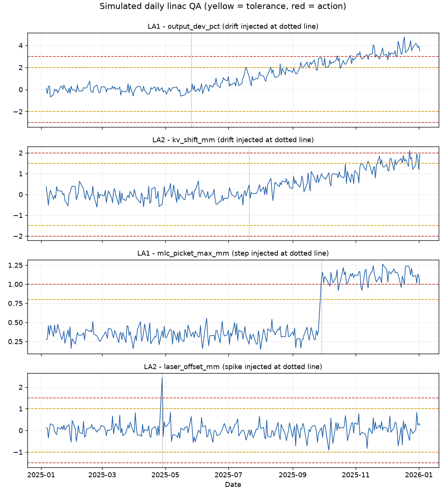

# Linac QA Analytics & Reporting Hub

A Python/SQL tool that turns daily linac QA measurements into trend analysis, early drift warnings, and auto-generated monthly QA reports.

> **Research/portfolio tool. Not for clinical use.** Built on simulated data. Tolerance levels are illustrative and must be replaced with AAPM TG-142 values and your clinic's policy before any real use.

## Why this exists
Medical physics teams spend a lot of time collecting QA results, checking them against tolerances, and writing summaries. This project automates the repetitive part so a physicist can review instead of assemble. It is meant to sit on top of exported QA data (for example, QATrack+ style exports) rather than replace those systems.

## Status
- [ ] Stage 1: Simulator, tests, demo plot (done); TG-142 tolerance values (in progress)
- [ ] Stage 2: SQL schema and loader
- [ ] Stage 3: Tolerance engine (pass / warning / action)
- [ ] Stage 4: Drift detection (EWMA and CUSUM)
- [ ] Stage 5: AI-model monitoring module (simulated Dice-score drift)
- [ ] Stage 6: Validation across many random seeds
- [ ] Stage 7: Power BI dashboard (fed by exported tables), monthly PDF report, daily digest
- [ ] Stage 8: Write-up and demo

See [docs/ROADMAP.md](docs/ROADMAP.md) for what each stage delivers.

## Inspiration
The idea of monitoring AI tools the same way machines are monitored, and of short automated daily summaries, is inspired by publicly described work from Mayo Clinic's Radiation Oncology AI & Data Analytics group. This is an independent project on simulated data and is not affiliated with Mayo Clinic.

## Quick start

Windows (PowerShell):
```powershell
python -m venv .venv
.venv\Scripts\Activate.ps1
pip install -r requirements.txt
pytest
$env:PYTHONPATH = "src"
python -m linac_qa.simulate --out data/simulated --seed 42
python scripts/plot_demo.py
```

macOS / Linux:
```bash
python -m venv .venv && source .venv/bin/activate
pip install -r requirements.txt
pytest
PYTHONPATH=src python -m linac_qa.simulate --out data/simulated --seed 42
PYTHONPATH=src python scripts/plot_demo.py
```

The last command writes `docs/img/demo_trend.png`. Requires Python 3.11 or newer.

## What the simulator produces
Two linacs (LA1, LA2), five parameters, and about 260 weekdays of data, plus a ground-truth file listing four injected problems:

| Event | Machine / parameter | Purpose |
|-------|---------------------|---------|
| Slow drift | LA1 output | Should be caught well before the action level |
| Slow drift | LA2 kV imaging shift | Second drift, different scale |
| Step change | LA1 MLC picket fence | Sudden shift, like after a repair |
| One-day spike | LA2 laser | Transient; should not be reported as a trend |

Because the truth is known, detection quality can be measured (Stage 6).



## Layout
```
config/tolerances.toml   tolerance and action levels (illustrative for now)
src/linac_qa/            package code (simulate.py now; db, engine, report later)
tests/                   pytest
scripts/                 plotting and helper scripts
docs/                    project plan, design notes, images
data/simulated/          generated data (simulated only)
```

## Limitations
- Simulated data only; no real clinic or patient data is used.
- Tolerance and action levels are illustrative until replaced with TG-142 values and local policy.
- Not validated for clinical use and must not be used for clinical decisions.
